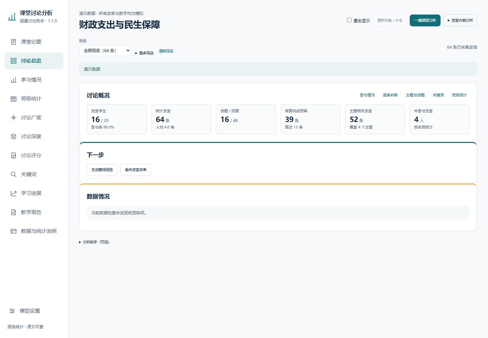

# 超星课堂讨论分析助手

面向教师的浏览器扩展：整理超星课程话题与回复，查看参与情况、聚焦观点、讨论分歧与原文依据。支持本地统计、按需联网分析、课堂记录保存和成绩表导出。

当前版本：**1.1.0**。适用于支持 Manifest V3 的 Chrome、Edge 浏览器。



## 能做什么

| 使用场景 | 功能 |
| --- | --- |
| 课前整理 | 按班级、话题和时间采集发言，合并重复记录，检查回复完整性 |
| 课堂讨论 | 整理集中观点、分歧、待解决问题和局部共识，可回看引用原文 |
| 参与观察 | 查看参与人数、人均发言、回复互动和活跃时段 |
| 内容分析 | 查看主题提及、关键词词云、内容深度及论证表现 |
| 学习进展 | 按讨论日期或已保存课次查看个人变化，对照前后发言 |
| 讨论评价 | 按六个维度生成建议分，展示理由与证据，支持教师调整 |
| 保存与分享 | 下载纪要、课堂备注和成绩 CSV，导出可恢复的 JSON 课堂备份 |

本地统计不需要模型密钥。课堂纪要、语义分析和 AI 评分需要自行配置兼容的模型接口，费用由所选服务商收取。

## 安装

1. 在 [Releases](https://github.com/Tcim1129/chaoxing-discussion-assistant/releases) 下载扩展 ZIP，并解压到固定文件夹。
2. 打开浏览器的扩展管理页面，启用“开发者模式”。
3. 点击“加载已解压的扩展程序”，选择包含 `manifest.json` 的文件夹。
4. 登录超星，进入课程的讨论区，点击页面上的“讨论分析”。

从源码安装时，请加载本仓库的 `extension/` 文件夹。

更新时替换原文件夹中的扩展文件，再在扩展管理页面点击“重新加载”，刷新课程页。保留原来的加载位置可延续浏览器内已有记录。

## 第一次使用

1. **选择采集范围**：先选班级，再选时间和话题。“全部时段”排在首位；课堂即时讨论可改成最近 1／2 小时或“开始本节课”。
2. **收集发言**：查看话题数、回复数和完整性提示。采集可暂停；暂停后可调整范围并重新采集。
3. **查看统计**：参与情况、词云和本地识别可直接查看。
4. **按需使用 AI**：打开“模型设置”，填写接口地址、模型名称与 API Key，保存并测试连接后再分析。
5. **保留记录**：使用 JSON 课堂备份恢复原文和分析状态；CSV、TXT 用于阅读与整理，不能替代完整备份。

想先看界面，可以在分析页的空状态中点击“查看演示界面”。仓库中的 [模拟讨论文件](examples/discussion-demo.json) 也可直接导入，全部内容均为虚构。

## 看懂结果

- **参与率**需要班级人数或名册作为分母；人数未确认时，不把未知学生计为未参与。
- **主题提及比例**表示发言中相关内容的覆盖程度，不等于认同程度、学习成绩或个人立场。
- **讨论深度与论证表现**应结合引用原文核对；发言次数或字数增加，不直接等同于能力提升。
- **建议分**采用教师设置的基础分、六维质量加分与行为扣分。当前量表的每维等级为 1～5，权重和计分规则可在“评分说明”查看。
- **缺项**不伪造为零分；按已评维度折算的建议分会保留缺项与核对提示。资料不足和模型未返回结果需要区别处理。
- **完整性提示**区分分页未读完与平台数量不一致。超星显示数量与实际返回内容可能不同，不能用虚构回复补齐。

个人评价适合在明确课次或学期范围、统一标准后使用；查看单条发言与查看整段话题链，材料范围也不同。

## 数据与隐私

讨论记录、模型设置和历史课堂保存在当前浏览器的扩展本地存储中。点击联网分析时，所选发言及必要上下文会发送到你配置的模型接口；点击“测试连接”也会调用该接口。

配置导出默认不含 API Key、密钥映射和最近使用记录。课堂备份可能仍含姓名、发言和课程信息，分享前需要单独检查；匿名显示不能替代文件脱敏。

详细说明见 [数据与权限](docs/PRIVACY.md)。本仓库只包含源码、模拟示例和模拟截图，不包含真实学生记录、个人配置、浏览器资料或本机开发历史。

## 开发与验证

扩展使用原生 JavaScript、HTML 和 CSS，采用 Manifest V3；本地统计与模型调用分开处理，无需前端构建步骤。

```sh
npm test
python scripts/package.py
```

`npm test` 使用 Node.js 20 或更新版本，运行源码语法检查、合成数据测试和公开文件检查，不调用收费模型。Python 打包脚本只收录扩展运行文件。

仓库中的测试全部使用合成材料；页面适配和模型接口能力仍需结合实际环境确认。反馈问题请使用 [问题模板](.github/ISSUE_TEMPLATE/bug_report.md)，不要附上真实课堂备份或密钥。

## 项目说明

这是独立的教学辅助工具，与超星及各模型服务商无隶属关系。课程平台更新可能影响采集，模型结果也需要教师核对。

当前未指定开源许可证。
